The classification of photographs helps us understand the intent behind their creation and the context in which they are consumed. While a photograph might technically belong to one genre upon creation, its genre can shift if the image is licensed or reused in a different context.[^genre_fluidity]

[^genre_fluidity]: For instance, a documentary photograph of a street scene might be purchased by a clothing brand decades later and used as commercial advertising, fundamentally changing its genre based on its new application.

# Major Photographic Genres

Understanding the distinctions between genres is crucial, as the boundaries can sometimes blur visually despite vastly different intentions and processes.

## Commercial and Editorial Photography

Commercial and editorial photography often share similar aesthetic qualities, and working photographers frequently hop between the two. However, their underlying goals and ownership structures are fundamentally different. 

**Commercial Photography**: Images created primarily to sell a product, service, or brand.
- The client (company/brand) is usually present during the shoot and dictates the visual direction.
- The photographer must adhere to the client's instructions.
- The company typically retains ownership of the photographs, which consequently pays more than editorial work.[^editorial_rates]

[^editorial_rates]: Editorial work (shooting for magazines or publications to accompany articles) usually pays less because the photographer retains the copyright and the creative freedom is generally higher.

> **Example**: Commercial Fashion
>
> Peng Chen photographed by Zhong Lin for Vogue Taiwan (January 2022) to sell high-end garments. The lighting, styling, and poses are meticulously controlled by a creative director to highlight the clothing over the individual's narrative.
>
> 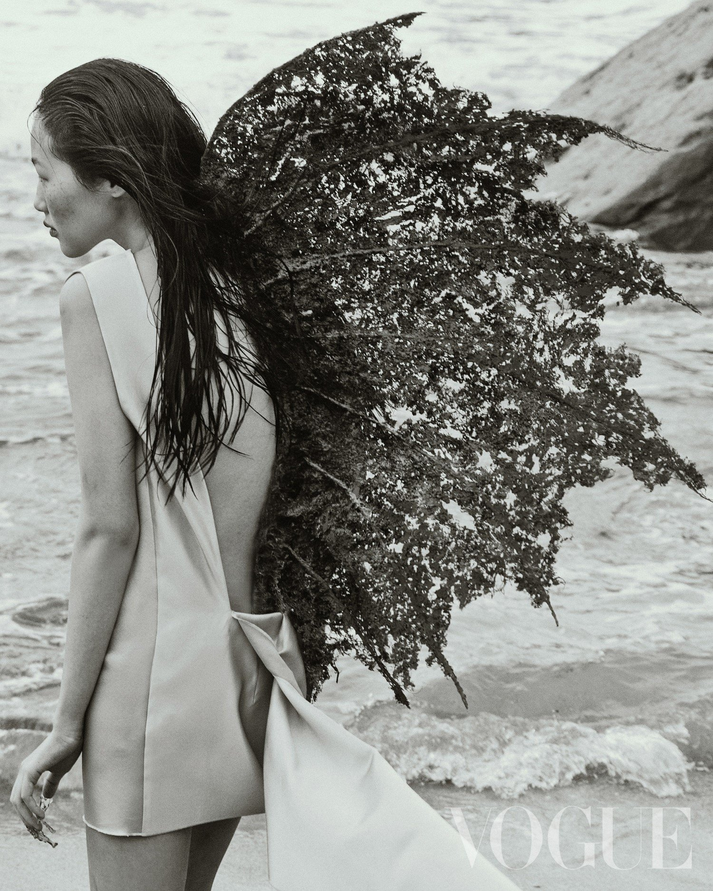
> 
> 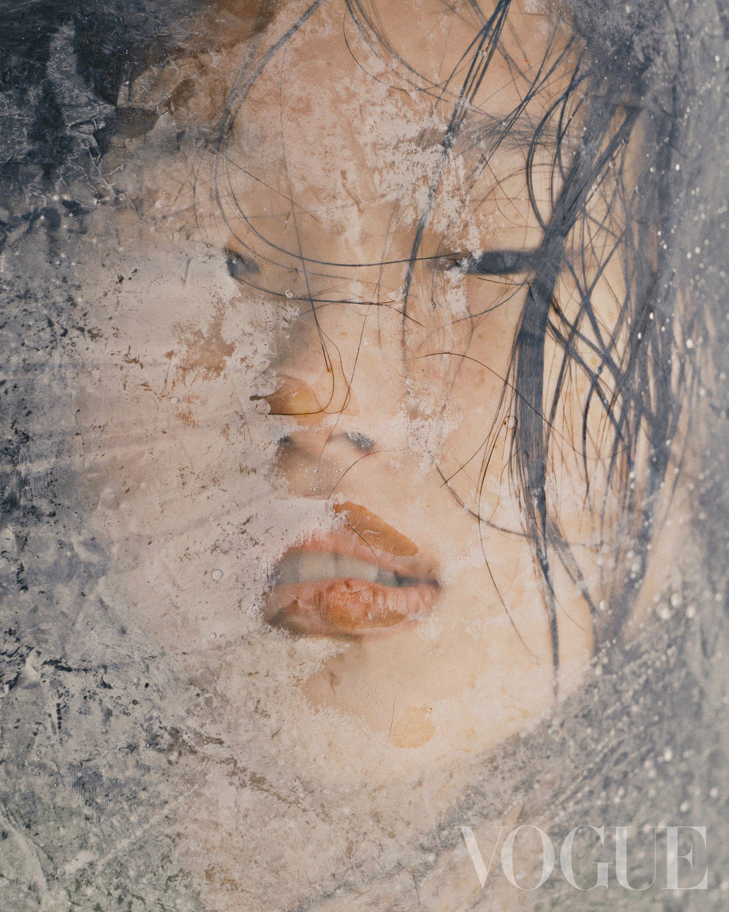
> 
> 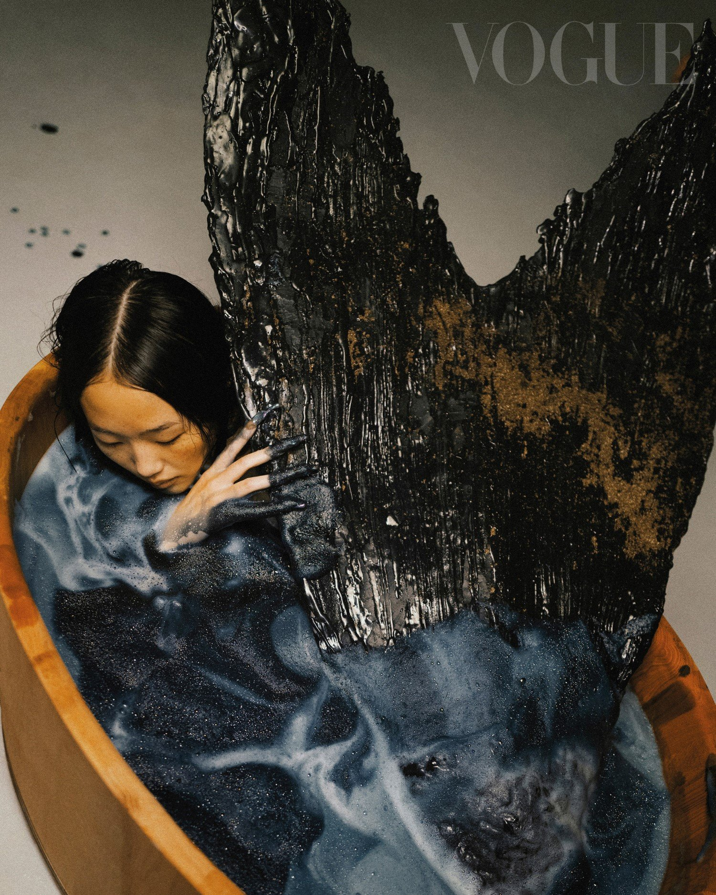

## Photojournalism

Photojournalism brings an added layer of real-world storytelling and immediacy compared to commercial work.

**Photojournalism**: Images created to visually communicate an aspect of a currently ongoing news story or event.
- Highly time-sensitive and tied to specific news cycles.[^news_cycle]
- Prioritizes factual accuracy and timely reporting over staged aesthetics.

[^news_cycle]: The relevance of a photojournalistic image is often directly tied to the 24-hour news cycle; its primary value is in its immediate dissemination to the public.

> **Example**: Headline News
>
> 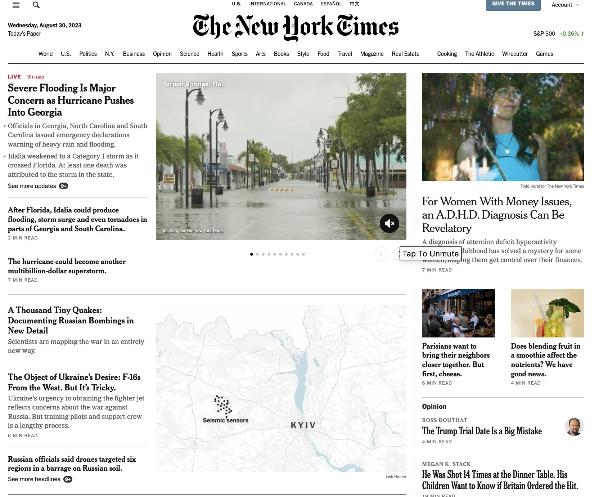

## Documentary Photography

Documentary photography requires a significantly larger investment of time and emotional labor than daily photojournalism. 

**Documentary Photography**: Long-term visual storytelling focused on a specific subject, theme, or social issue.
- Operates outside of immediate time frames or daily news cycle pressures.
- Requires the photographer to spend extensive time (months or years) getting to know their subjects intimately.
- Positions the photographer as a deep-dive observer and storyteller over an extended period.

> **Example**: Amazonian Dystopia
>
> A long-term project detailing environmental and social realities in South America. The photographer spent months embedded in the region, capturing the slow destruction of the landscape and its impact on indigenous communities, rather than covering a single day's news event.
> 
> 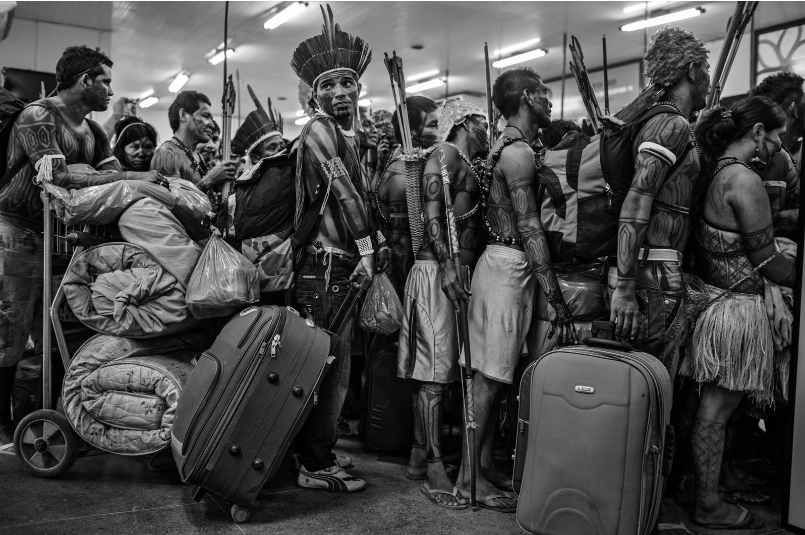
> 
> 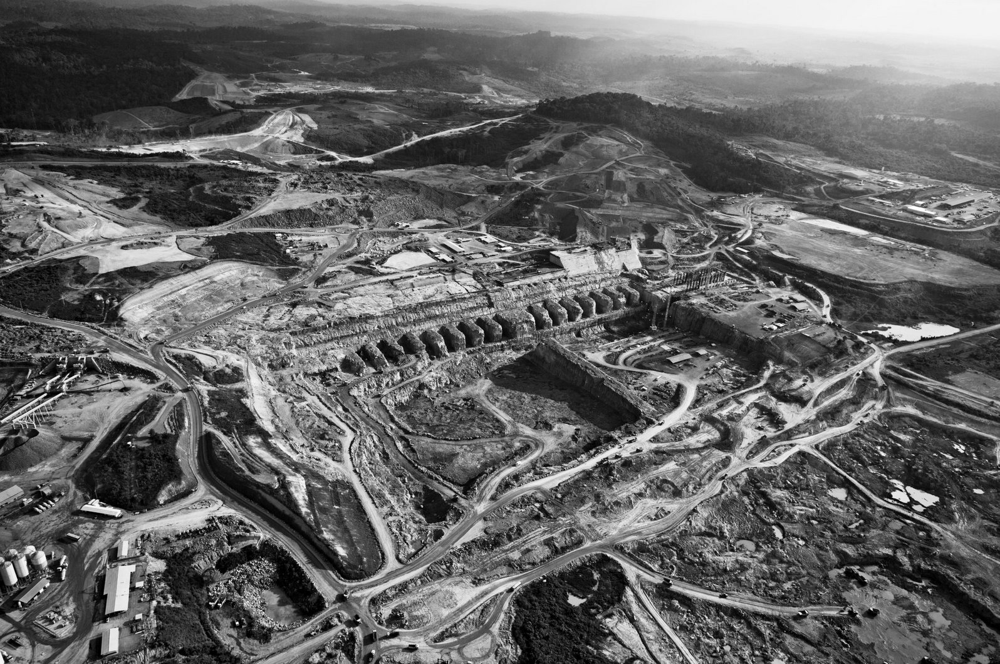
> 
> 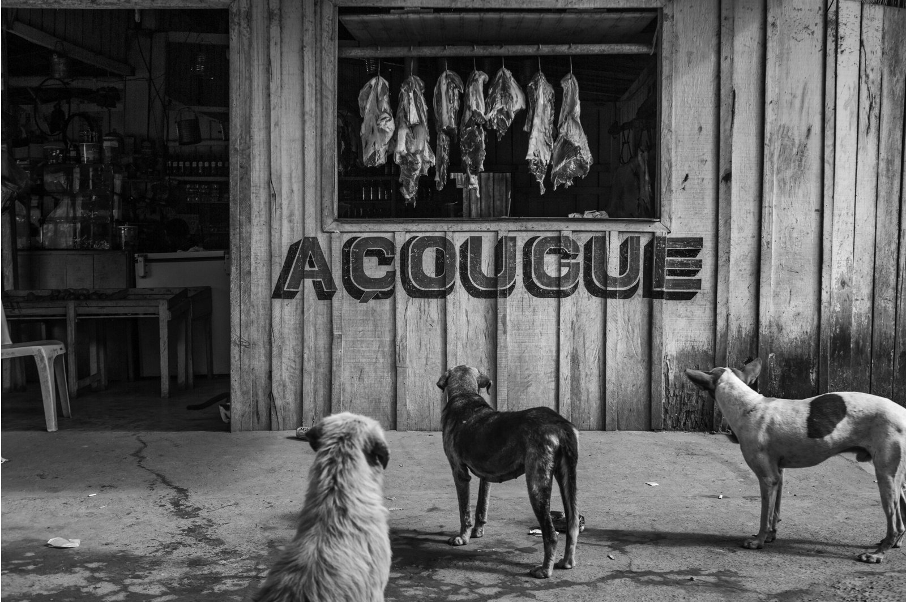
> 
> 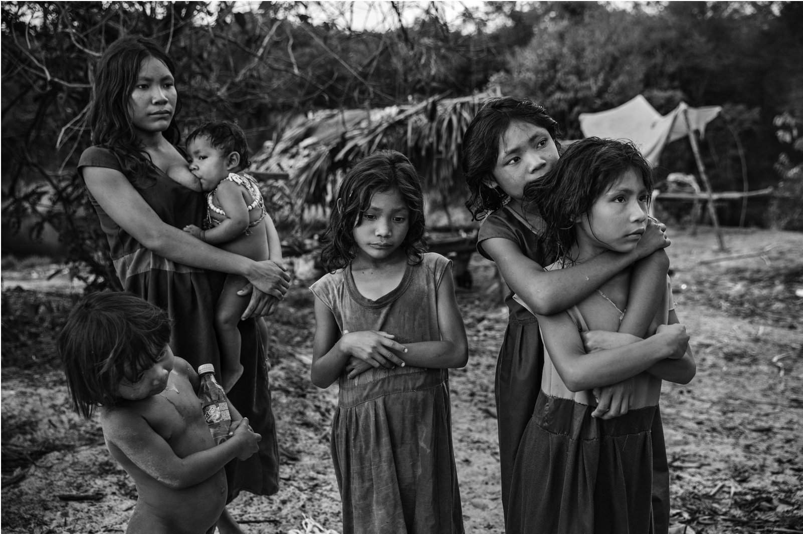

> **Example**: Migrant Mother
>
> A quintessential documentary photograph capturing the enduring struggles of the Great Depression. Dorothea Lange worked for the Farm Security Administration, traveling for years to build a comprehensive visual archive of rural poverty.
>
> 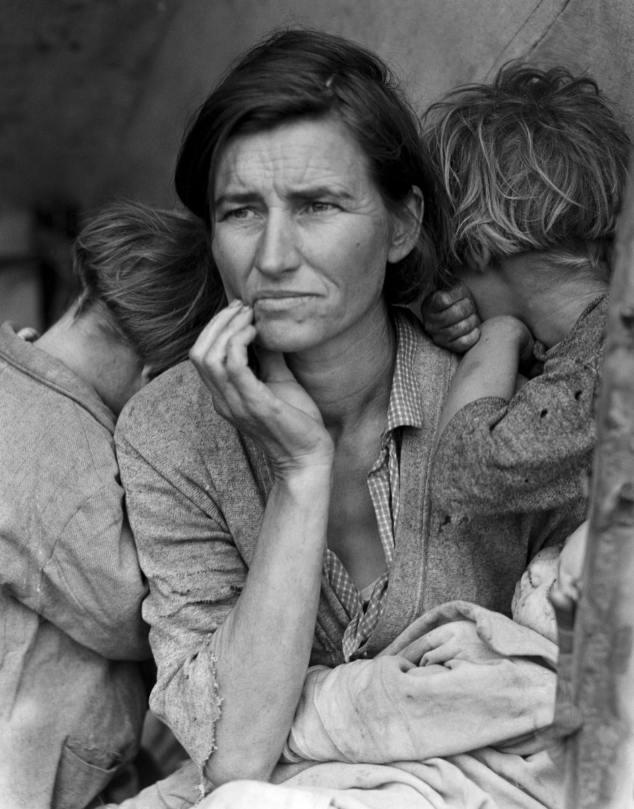

## Street Photography

Street photography shares DNA with documentary work but is typically less structured and more spontaneous.

**Street Photography**: Candid, non-fiction visual storytelling that captures everyday life in public spaces.
- Typically not done as an assignment for a publication.
- Often operates as a multi-year project that culminates in a collection of standalone, candid images rather than a singular, chronological narrative.

## Fine Art Photography

Fine art photography abandons the need for objective documentation entirely. 

**Fine Art Photography**: Images created primarily to illustrate a concept, emotion, or the artist's specific vision, rather than to document reality or sell a product.
- Prioritizes conceptual frameworks over factual reporting.
- Often explores aesthetics, psychology, or staged realities.[^staged_reality]

[^staged_reality]: In fine art, a photographer might hire actors, build sets, or heavily manipulate the image digitally. The "truth" of the image is emotional or conceptual, not literal.

> **Example**: Fine Art Portfolios
>
> 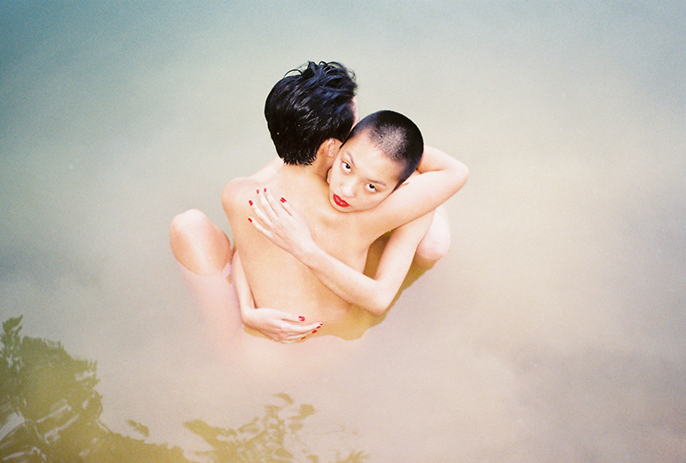
> 
> 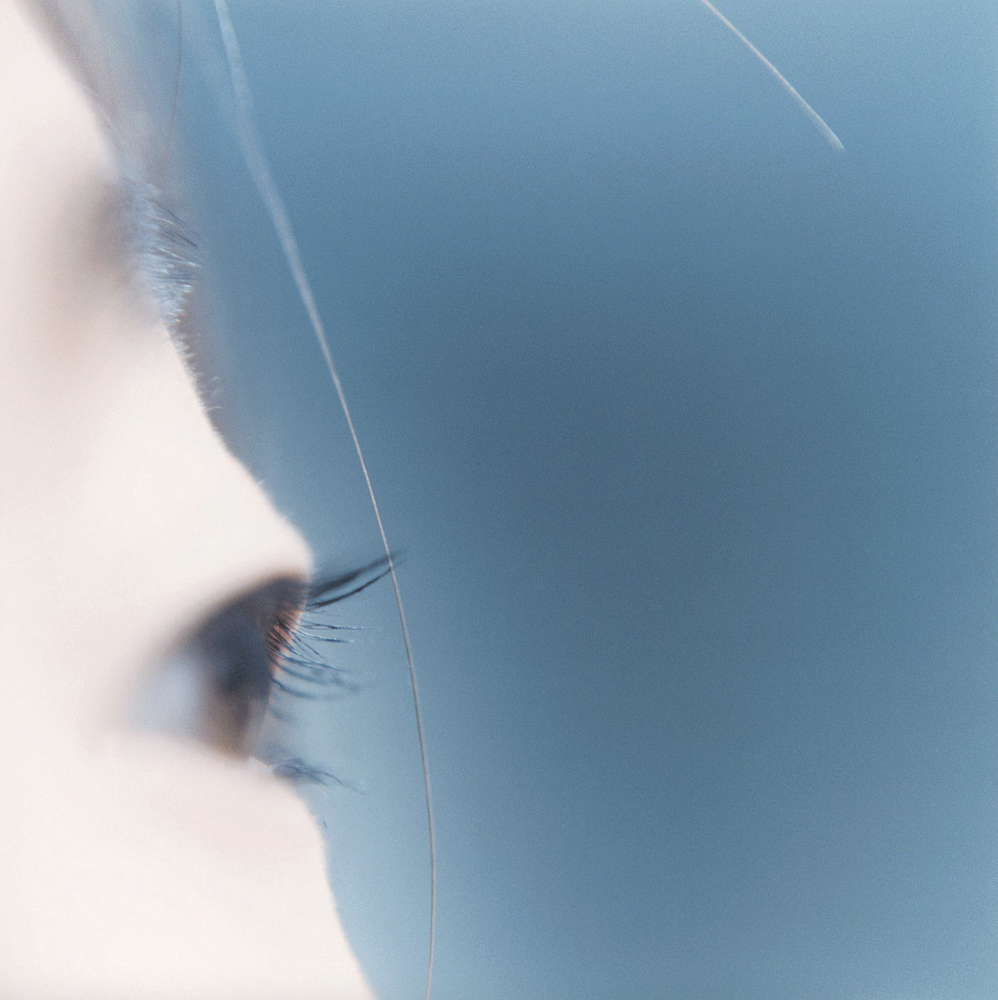
> 
> 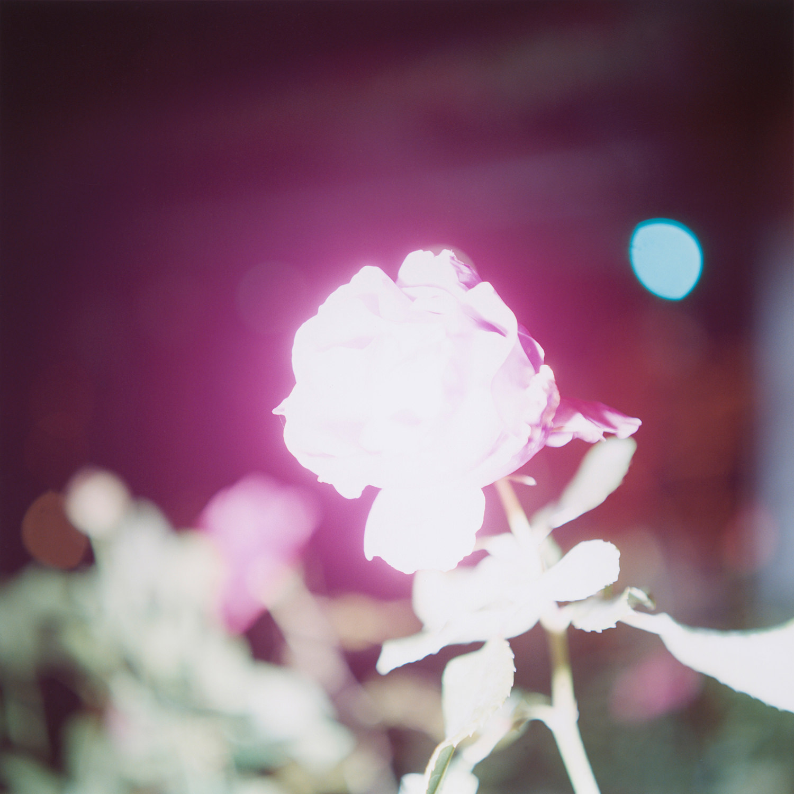
> 
> 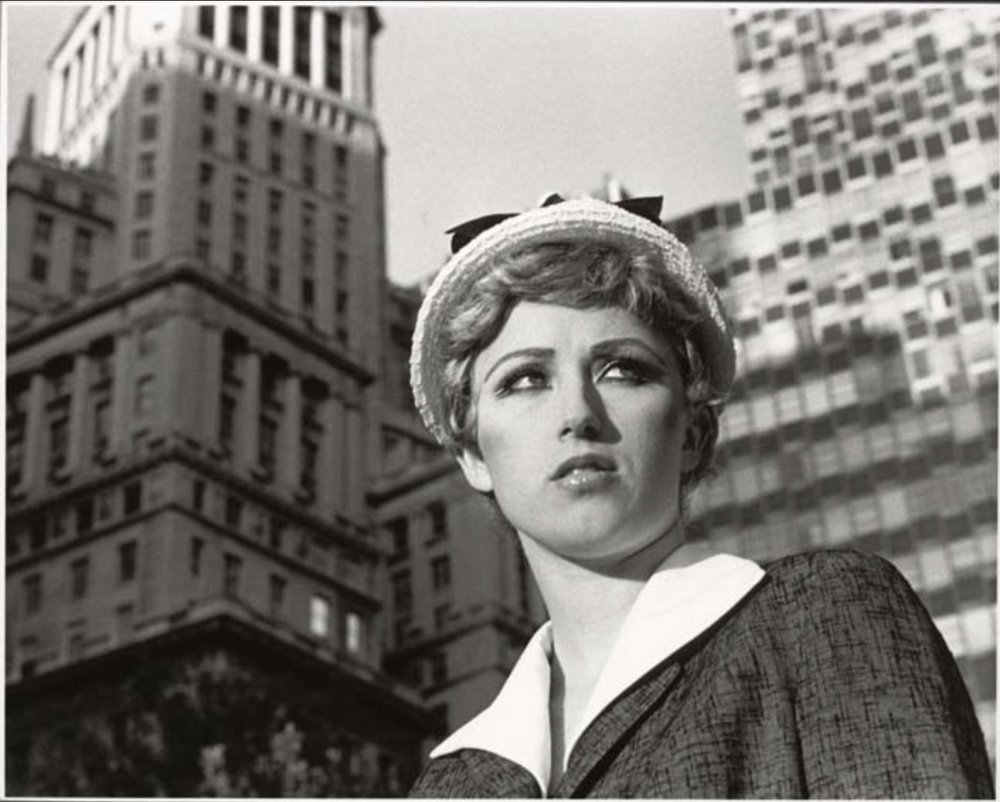
> 
> Cindy Sherman's "Untitled Film Stills" feature the artist dressing up as various cinematic archetypes (the housewife, the ingenue, the woman in peril). They look like documentary stills from 1950s movies, but are entirely fabricated to critique societal roles.

