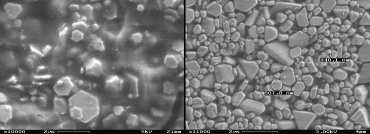
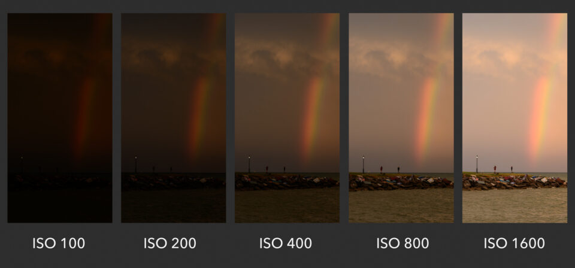
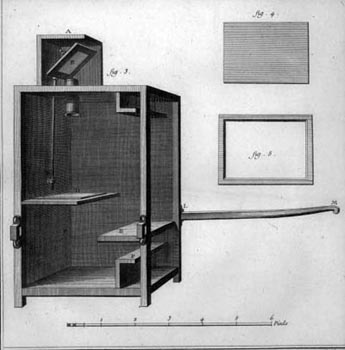
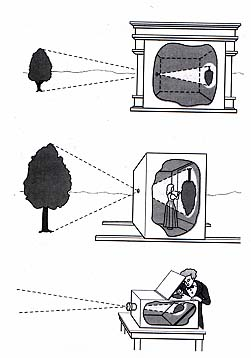

The creation of a photograph is fundamentally a mechanical and chemical (or digital) process of capturing light. A perfectly exposed picture is a careful balance of functions that dictate how much light hits the sensor or film, and how sensitive that medium is to the light.

# The Mechanics of Exposure

Exposure in a camera is controlled by balancing depth of field,[^depth_of_field] motion blur, and light sensitivity. Generally, a photographer hones in on the aperture they want to achieve a specific depth of field before choosing their shutter speed or altering sensitivity.

[^depth_of_field]: The distance between the nearest and furthest elements in a scene that appear to be "acceptably sharp" in an image. Controlled primarily by the lens aperture (f-stop).

### Light Sensitivity

The baseline foundation of any exposure calculation is determining how receptive your recording medium is to light.

**ISO**: A numerical rating representing a camera's sensitivity to light, pertaining to either the film stock or a digital sensor.
- A lower ISO value (e.g., ISO 100) means less sensitivity to light and is ideal for bright lighting situations.
- A higher ISO value (e.g., ISO 800 or 1600) means more sensitivity, making it suitable for low-light situations. 
- Pushing ISO too high creates digital noise or heavy film grain.[^film_grain]

[^film_grain]: On analog film, higher sensitivity requires physically larger silver halide crystals in the emulsion, which become visible as a gritty texture ("grain") when developed and printed.

> **Example**: Film Grain Structure
>
> Microscopic view of silver halide particles embedded in gelatin and spread across a polyester base. Shows the difference in particle size/density between Low ISO and High ISO film.
> 
> 

> **Example**: ISO Brightness Comparison
>
> 

### Exposure Blunders

When the balance of light, time, and sensitivity fails, the image breaks down in one of two directions.

**Overexposure**: A state where too much light is allowed in during the exposure, resulting in an overly bright, washed-out photograph.
- Highlights lose all detail and become pure white.

**Underexposure**: A state where too little light is allowed in during the exposure, resulting in an overly dark photograph.
- Details are completely lost in shadow areas, rendering them pitch black.

# The Camera Obscura

Long before chemical photography was invented to permanently fix an image, artists used optical principles to project images of the real world for observation and tracing.

**Camera Obscura**: An optical device (literally translating to "dark room") that projects an inverted image of its surroundings onto a screen or wall.[^pinhole_effect]
- Originally used as an aid to drawing and painting.
- Smaller tabletop versions were eventually developed with lenses to help the user focus their subject onto a glass plate on top of the device for tracing.

[^pinhole_effect]: The fundamental optical principle where light rays from an illuminated scene pass through a small hole in a darkened enclosure, crossing paths and projecting an upside-down, reversed image on the opposite wall.

> **Example**: Historical Camera Obscuras
>
> Early camera obscuras were literal rooms that an artist would stand inside. Later, portable wooden boxes were developed with a mirror inside at a 45-degree angle, projecting the image up onto a piece of frosted glass so the artist could lay paper over it and trace.
>
> 
> 
> 
