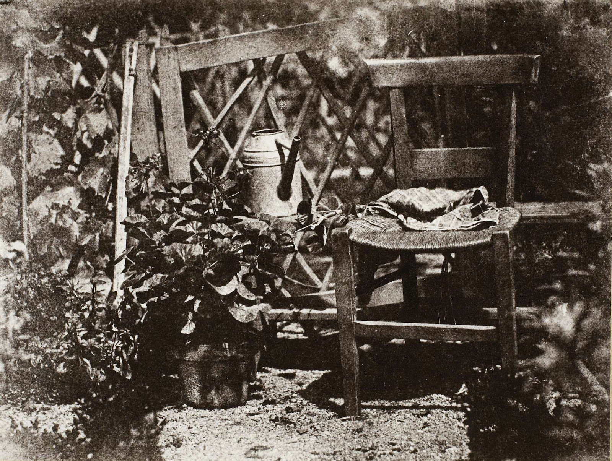
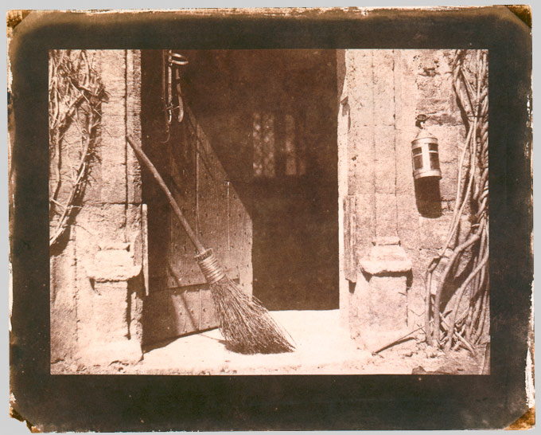

The development of photography happened in phases, with multiple inventors working simultaneously to solve the problem of permanently fixing an image captured by a camera obscura. These early technological advancements profoundly disrupted the traditional art world.

# Impact on the Art World

Before the daguerreotype became widespread, creating a likeness of someone through painting or drawing was prohibitively expensive. Photography democratized the image but also caused an existential crisis for painters. Freed from the burden of strict realistic documentation, painters began exploring light, time, and abstraction.

**The Impressionist Revolt**: An artistic shift where painters rebelled against the hyper-detail of photography by intentionally exploring loose brushwork, abstraction, and the passage of time.
- Claude Monet focused on light studies of the same place at different times, embracing the physical materiality of paint.[^materiality]
- Marcel Duchamp combined multiple "frames" of movement into a single, mechanistic image (Futurism).
- Hilma af Klint invented abstract painting in the 19th century as a complete move away from pure representation.

[^materiality]: By allowing brushstrokes to remain visible and textured, painters emphasized that a painting is a physical object made of pigment and oil, something the smooth, mechanical surface of a photograph could not replicate.

> **Example**: Monet's Rouen Cathedral
>
> Monet painted the facade of the Rouen Cathedral over 30 times, focusing not on the architectural details (which a camera could capture perfectly), but on how the changing sunlight altered the colors and mood of the stone at different times of day. 

# Pioneering Processes

Different inventors developed competing chemical processes to capture images, each introducing a distinct visual language and workflow to the medium.

## The Calotype

William Henry Fox Talbot worked in England and occupied a similar societal status as early French inventors, possessing the time, resources, and wealth to experiment. 

**Calotype**: A photographic process that produced a negative image on paper, which could then be used to print multiple positive copies.[^negative_positive]
- Talbot had a revelation while on vacation in Italy: while using a drawing aid, he realized there could be a mechanical way to document what he was seeing.
- Back home, he experimented extensively with small camera obscuras to develop his negative-to-positive process.

[^negative_positive]: This was Talbot's greatest contribution to modern photography. While the French Daguerreotype produced a single, un-reproducible image on metal, the Calotype's paper negative allowed for infinite duplication.

## The Direct-Positive Process

Hippolyte Bayard created an early process that was the least likely of the major inventions to succeed commercially, but it was highly influential artistically.

**Direct-Positive Process**: A process that creates a unique, positive image directly onto paper without the intermediate step of a negative.
- The results were not as crystal clear as other early methods; they often looked blurry and faded.
- It was essentially the predecessor to the modern Polaroid, though not commercially viable for another century.
- The workflow required fewer steps than Talbot's negative-to-positive method.

> **Example**: Self Portrait as a Drowned Man
>
> Hippolyte Bayard invented his process before Louis Daguerre, but the French government persuaded him to delay his announcement so they could champion Daguerre's process instead. In protest of being erased from history, Bayard created a photograph of himself portraying a rotting, drowned corpse. He wrote a lengthy, morbid fictional story on the back detailing how the government's neglect drove him to suicide—making it arguably the first instance of conceptual or staged fine art photography.

## Wet Collodion

Eventually, the benefits of varying processes were merged into a highly detailed, though cumbersome, system.

**Wet Collodion on Glass**: A chemical process that refined the best aspects of early photography by using highly sensitive chemicals poured onto glass plates.
- Allowed for incredibly detailed, sharp images.
- Required an ISO of about 5, meaning a massive amount of light was still needed for proper exposure.
- Frederick Scott Archer never patented the process,[^open_source] making it the first "open-source" photographic process so others could improve upon it.

[^open_source]: Because Archer freely gave the process to the public domain, Wet Collodion rapidly replaced almost all other competing photographic methods globally by the late 1850s.

# Comparing Early Works

When analyzing early photography, comparisons must happen on two levels: what is visually apparent, and the contextual reasons of how and why the photo was made.

> **Example**: The Open Door vs. Untitled, Garden Series
>
> Compare William Henry Fox Talbot's "The Open Door" (1844) and Hippolyte Bayard's "Untitled, Garden Series" (1839).
> 
> 
> 
> 
> 
> Similarities:
> - Visible: Both are taken outdoors using sunlight; both are domestic scenes around the photographer's house; both place the center of interest close to the center of the frame.
> - Context: Both are early experiments by individuals refining their own unique processes. Both document a situation rather than telling a narrative story.
> 
> Differences:
> - Visible: Talbot's image features diffused light with soft-edged shadows, while Bayard's features harsh, direct light. Talbot's paper negative leaves a thick, dark, textured border around the final print.
> - Context: Talbot's is a negative-to-positive print, while Bayard's is a direct positive on paper.

